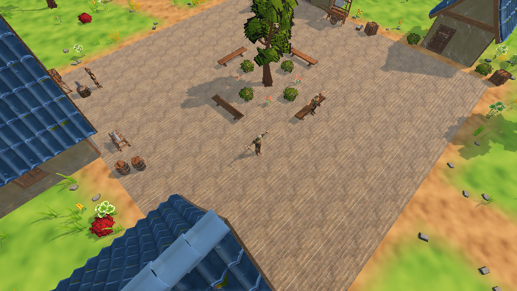
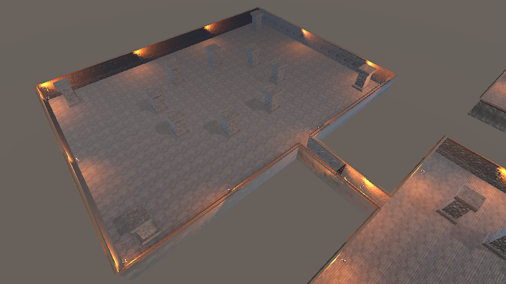
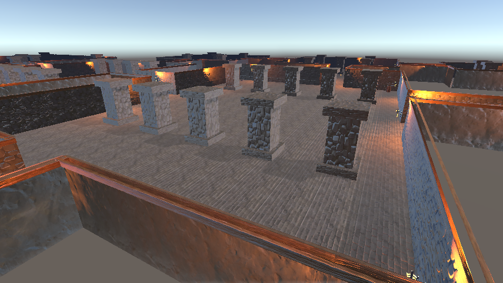
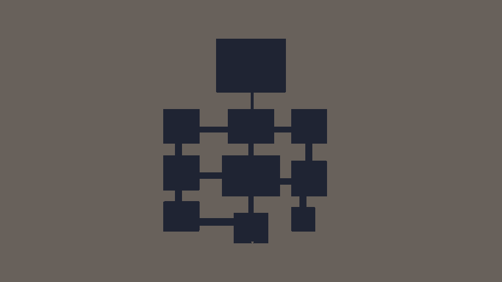

# GrimHollow

마을과 필드, 던전을 오가며 몬스터를 처치하고 열쇠를 얻어 보스에 도전하는 **3D 쿼터뷰 액션 RPG**입니다. (Unity 6 / URP, 1인 개발)

| 마을 | 던전 보스 방 |
|---|---|
|  |  |

| 던전 중앙 홀 | 던전 지도 구조 (위에서 본 모습) |
|---|---|
|  |  |

> 플레이 영상은 아직 없습니다. 위 화면은 Unity 에디터에서 캡처한 것입니다.

## 주요 기능

- **직업 선택**: 전사 / 마법사, 성별별 캐릭터, 직업에 따라 다른 무기와 전투 방식
- **마을 → 필드 → 던전**: 씬 포탈과 페이드 전환, NPC와 상점 분위기의 마을
- **던전 1층 (약 112 × 140 m)**: 방 10개를 복도로 연결, 방마다 몬스터 배치, 고리 모양 우회로, 보물 방
- **열쇠와 보스 방**: 북서쪽 방의 중간보스를 잡으면 열쇠 획득 → 철문을 열고 보스 방 입장 → 문이 닫히고 보스전
- **미니맵**: 지나간 곳과 들어가 본 방만 드러나며 `M` 키로 전체 지도
- **보스전 (버섯왕)**: 바닥 예고 장판 → 회피 → 빈틈 공격, 2페이즈(포효, 충격파, 연속 내려찍기), 쫄몹 소환
- **전투**: 마우스를 바라보며 이동·공격, 공격 중 걷는 속도로 이동, 경직 게이지 기반 피격 반응, 짧은 무적 대시
- **전사 스킬**: `Q` 강철의 의지(받는 피해 30% 감소), `E` 회전 베기(주변 광역 + 넉백), 우클릭 돌진 베기
- **아이템**: 몬스터 드롭, 상자, 인벤토리/장비 창, 회복 포션, 골드

## 조작법

| 키 | 동작 |
|---|---|
| `WASD` | 이동 (화면 기준) |
| 마우스 | 바라보는 방향 |
| 좌클릭 | 기본 공격 (누르고 있으면 연속) |
| `Space` | 대시 |
| `Q` / `E` / 우클릭 | 전사 스킬 (마법사는 `Q` 하나) |
| `1` | 포션 사용 |
| `E` | 상자·문 상호작용 |
| `I` | 인벤토리 |
| `M` | 전체 지도 |

## 기술 포인트

- **던전 자동 생성 에디터 도구** (`Scripts/Editor/DungeonBuilder.cs`): 방과 복도의 사각형 목록만 고치면 바닥, 벽, 충돌, 횃불, 기둥, 상자가 만들어지고 NavMesh를 다시 구움
- **미니맵** (`Scripts/UI/DungeonMinimap.cs`): 시작할 때 NavMesh를 샘플링해 지도 이미지를 만들고, 탐험한 곳만 드러남
- **던전 진행** (`Scripts/World/DungeonDirector.cs`): 방별 몬스터 배치, 중간보스와 열쇠, 보스 방 진입 연출
- **카메라 가림 처리** (`Occludable`, `OcclusionHider`): 캐릭터를 가리는 벽과 건물만 반투명
- **공통 몬스터 구조** (`MonsterController`, `MonsterHealth`): 프리팹 값만 다르게 해서 슬라임, 오크, 보스에 재사용
- **효과음 재생** (`Sfx`): 빠른 연속 공격에서 소리가 겹치지 않도록 두 개의 소스로 번갈아 재생

## 실행 방법

1. Unity 6000.6 으로 프로젝트를 엽니다.
2. `Assets/_GrimHollow/Scenes/Title.unity` 에서 Play 합니다. (에디터에서는 Play 시 항상 Title부터 시작합니다. `GrimHollow > Play From Title` 로 끌 수 있습니다.)
3. 던전 맵을 다시 만들려면 Dungeon 씬에서 `GrimHollow > Build Dungeon Room` 을 실행합니다.

## 외부 에셋에 대하여

용량과 라이선스 때문에 `Assets/ThirdParty/` 폴더는 저장소에 포함하지 않았습니다. (Quaternius 캐릭터·몬스터·소품, Mixamo 애니메이션, Hovl 이펙트, Kenney·StarNinjas·qubodup 효과음 등) 이 폴더가 없으면 모델과 소리가 비어 보일 수 있고, 코드와 씬 구조는 그대로 확인할 수 있습니다.
